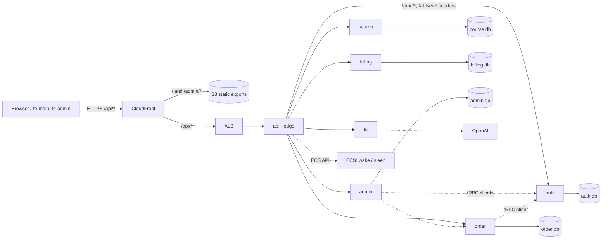

# bf - architecture

> The technical "how it is **built**" doc - **structure and boundaries**, not behavior.
> How the system _behaves_ lives in the [capability specs](../specs/); decisions (why) live in
> the [ADRs](decision-records/adr/README.md). Kept current; a change to a boundary or a
> component updates this file in the same PR.

## Overview

A pnpm/Turborepo monorepo: one edge service, six NestJS domain services (each with its own
Postgres database and its own tRPC router), two Next.js static front ends, shared packages,
and AWS CDK infrastructure. In production every Nest app is an ECS Fargate service behind one
CloudFront distribution; domain services scale to zero and are woken by the edge.

## Diagrams - the C4 model

- **Context (level 1):** the system is the malinina.ca platform; its users are the personas in
  [`personas.md`](personas.md) (learners/customers on the public site, the owner and admins in
  the back office); external systems: OpenAI (LLM), AWS (ECS, Aurora, S3, CloudFront), a
  payment provider (not integrated yet - `billing` is a skeleton).
- **Container (level 2):** the diagram above. Deployable units: `api`, `auth`, `order`,
  `course`, `billing`, `admin`, `ai` (Fargate services), `fe-main` and `fe-admin` (S3 +
  CloudFront), Aurora Serverless v2 (one cluster, one database per service), migration tasks.
- **Component (level 3):** inside each service, the Domain-Driven Hexagon layout of
  [`docs/standards/domain-driven-hexagon/bf-mapping.md`](standards/domain-driven-hexagon/bf-mapping.md)
  section 2 - modules, vertical slices, domain / application / infrastructure, tRPC routers as
  driving adapters, Drizzle repositories as driven adapters.
- **Code (level 4):** skipped; the code and the specs are the truth.

## Components

| Component                                       | Responsibility                                                                                                                                                                                                                                                                                                                                                                                                                                                   | Stack                                                                                                  |
| ----------------------------------------------- | ---------------------------------------------------------------------------------------------------------------------------------------------------------------------------------------------------------------------------------------------------------------------------------------------------------------------------------------------------------------------------------------------------------------------------------------------------------------- | ------------------------------------------------------------------------------------------------------ |
| `apps/api` (edge, :3000)                        | verifies the RS256 JWT (`JWT_PUBLIC_KEY`), strips client `X-User-*` headers and re-attaches the verified identity, enforces `ROUTE_ROLES`, per-identity rate limit, proxies `/<svc>/*` to `UPSTREAMS`; hosts the **orchestrator** that wakes sleeping services and puts them to sleep after a cooldown (state = ECS `desiredCount` + service tags, no extra store); exposes the admin-only control controller `/_services` (list, wake, sleep, cooldown, bounds) | NestJS 12, http-proxy-middleware, `@nestjs/throttler`, AWS SDK v3 (ECS, Application Auto Scaling, RDS) |
| `apps/auth` (:3001)                             | identity: users, refresh tokens (sha256 at rest, rotating), RS256 token issue/refresh/revoke, `/auth/jwks`, a dev-only `dev-token` endpoint; external login providers not implemented                                                                                                                                                                                                                                                                            | NestJS, `@nestjs/jwt`, Drizzle, class-validator on the REST controller                                 |
| `apps/order` (:3002)                            | orders (skeleton): CQRS wiring, `outbox` and `processed_events` tables, tRPC client to `auth`                                                                                                                                                                                                                                                                                                                                                                    | NestJS, `@nestjs/cqrs`, Drizzle, `@bf/events`                                                          |
| `apps/course` (:3003)                           | courses catalogue (skeleton)                                                                                                                                                                                                                                                                                                                                                                                                                                     | NestJS, Drizzle                                                                                        |
| `apps/billing` (:3004)                          | invoices (skeleton)                                                                                                                                                                                                                                                                                                                                                                                                                                              | NestJS, Drizzle                                                                                        |
| `apps/admin` (:3005)                            | back office: `audit_log` table, tRPC clients to the other services                                                                                                                                                                                                                                                                                                                                                                                               | NestJS, Drizzle, `@bf/trpc` clients                                                                    |
| `apps/ai` (:3006)                               | LLM facade: `@bf/llm` port with the OpenAI adapter and an in-memory double; no procedures yet                                                                                                                                                                                                                                                                                                                                                                    | NestJS, `openai`                                                                                       |
| `apps/fe-main` (:4000), `apps/fe-admin` (:4001) | public site and admin UI, static exports; call the edge only                                                                                                                                                                                                                                                                                                                                                                                                     | Next.js 15, React 19, Tailwind 4, `@bf/ui`                                                             |
| `packages/contracts`                            | hand-written zod schemas + generated `AppRouter` types per service                                                                                                                                                                                                                                                                                                                                                                                               | zod, nestjs-trpc CLI                                                                                   |
| `packages/trpc`                                 | tRPC server context (identity from trusted headers, correlation id), `AuthedMiddleware`/`AdminMiddleware`, typed clients that propagate identity and correlation id                                                                                                                                                                                                                                                                                              | nestjs-trpc, `@trpc/server`, `@trpc/client`                                                            |
| `packages/server`                               | bootstrap, `CoreModule`, env validation (`createEnvValidator`, `baseEnvSchema`), health module (`/health/live`, `/health/ready`)                                                                                                                                                                                                                                                                                                                                 | NestJS, `@nestjs/terminus`, Pino                                                                       |
| `packages/shared`                               | DDD base classes (`Entity`, `AggregateRoot`, `ValueObject`, `createDomainEvent`, `DomainException`, `Result`), filters (problem details, domain exception mapping), guards, interceptors, logger, CLS                                                                                                                                                                                                                                                            | framework-free `ddd/`, NestJS for the rest                                                             |
| `packages/events`                               | integration-event envelope (zod), `OutboxEventPublisher`, outbox/inbox table factories                                                                                                                                                                                                                                                                                                                                                                           | Drizzle, zod                                                                                           |
| `packages/db`                                   | Drizzle module/provider, env, `ensure-database`, migrate CLI                                                                                                                                                                                                                                                                                                                                                                                                     | drizzle-orm, pg                                                                                        |
| `packages/storage`, `packages/llm`              | S3 port (MinIO locally, task role on AWS) and LLM port with in-memory doubles                                                                                                                                                                                                                                                                                                                                                                                    | AWS SDK v3, openai                                                                                     |
| `packages/config`                               | ESLint flat presets, tsconfig bases, prettier preset                                                                                                                                                                                                                                                                                                                                                                                                             | ESLint 10, TypeScript 6                                                                                |
| `infra/aws`                                     | two CDK stacks `bf-prod` (platform) and `bf-prod-apps` (services); ops scripts (`release.ts`, `static-deploy.ts`, `services.ts`, `exec.ts`, `db-*.ts`)                                                                                                                                                                                                                                                                                                           | AWS CDK v2, AWS SDK v3, TypeScript run by `node`                                                       |
| `infra/*`                                       | local compose files per dependency (postgres, redis, kafka, debezium, nats, rabbitmq, clickhouse, elastic, minio, mongo, prometheus, grafana, otel); only postgres, minio and otel are used by the code today                                                                                                                                                                                                                                                    | docker compose                                                                                         |

## Boundaries and invariants

- **The edge is the only component that verifies tokens** (ADR-019). Services run on the
  private Service Connect network and trust the `X-User-*` headers the edge sets; the edge
  strips those headers from clients first. Browsers never reach a service directly.
- **One database per service** (ADR-018); no service reads another's tables. Cross-service
  data flows through tRPC calls (synchronous, identity propagated) or integration events
  through the transactional outbox (ADR-005/006); no dual writes.
- **Contract-first tRPC only** between our own components (ADR-017); no REST except the
  recorded auth endpoints and health.
- **Inside a service: Domain-Driven Hexagon** (ADR-025) - domain free of frameworks, ports and
  adapters, `pnpm deps` enforces the import rules.
- **Services must be able to sleep** (ADR-023): `/health/live` never touches the database;
  Aurora pauses at 0 ACU; the first request to a sleeping service gets `503 + Retry-After` while
  the orchestrator wakes it (30-60 s).
- **Global DI tokens are `Symbol.for('bf.*')`** (ADR-012) because packages ship subpath bundles.
- **Everything we author is TypeScript** (ADR-022); CJS everywhere (ADR-001); one Nest copy
  pinned through `pnpm.overrides` (ADR-015).

## Data

| Store                                 | Owner                       | Contents                                        | Migration approach                                                                          |
| ------------------------------------- | --------------------------- | ----------------------------------------------- | ------------------------------------------------------------------------------------------- |
| Postgres `auth`                       | `apps/auth`                 | users, refresh tokens                           | drizzle-kit, committed under `apps/auth/drizzle`, run as a one-off Fargate task per release |
| Postgres `order`                      | `apps/order`                | orders (skeleton), `outbox`, `processed_events` | same                                                                                        |
| Postgres `course`, `billing`, `admin` | the respective service      | catalogue / invoices (skeletons); `audit_log`   | same                                                                                        |
| S3 (`@bf/storage`)                    | per bucket, e.g. `bf-order` | files                                           | n/a                                                                                         |
| ECS service tags                      | `apps/api` orchestrator     | sleep/wake cooldown state                       | n/a (no extra store - ADR-023)                                                              |

Locally one Postgres container holds all databases, created by
`infra/postgres/postgres-init/01-init.sql`; on AWS one Aurora Serverless v2 cluster does the
same. The executable DDL twin the standard asks for (R24, `database/schema/`) is open work
(`DB-SCHEMA-1`).

## Integrations

| External system                                            | How                                                                                                                           | Auth                                      |
| ---------------------------------------------------------- | ----------------------------------------------------------------------------------------------------------------------------- | ----------------------------------------- |
| OpenAI                                                     | `@bf/llm` OpenAI adapter behind the LLM port; tests use the in-memory double                                                  | API key from the environment (ECS secret) |
| AWS ECS / Application Auto Scaling / RDS / S3 / CloudFront | AWS SDK v3 from `apps/api` (orchestrator) and the CDK/ops scripts; resources discovered by name and tags, never by ids in env | task role / the operator's credentials    |
| Payment provider                                           | not integrated (`billing` is a skeleton)                                                                                      | -                                         |

## Runtime and deploy

- **Local:** `pnpm stack:up` (root `docker-compose.yml`: postgres, redis, minio, migrate, 7
  services, 2 Next apps) or `pnpm infra:core && pnpm dev` on the host. Ports `:300x`, `:400x`.
- **Production (ADR-023):** `cdk deploy` of `bf-prod` + `bf-prod-apps`; every Nest app is an
  ARM64 Fargate task (0.5 vCPU / 1 GB); `api` is always on (1-4 tasks); the others sleep at 0
  tasks and wake on demand; Next exports live in S3 behind CloudFront (`/`, `/admin/*`,
  `/api/*` -> ALB -> `api`); migrations run as one-off Fargate tasks before each service's
  rolling deploy; the deployment circuit breaker rolls back an unhealthy task definition.
- **Pipeline:** `.github/workflows/pipeline.yml` is the one path from PR to production
  (`ci ok` required; snapshot, cdk deploy, images, release per service, smoke test);
  `db-snapshot.yml` snapshots Aurora; `spec-guard.yml`, `gitleaks.yml` and
  `standards-update-watch.yml` are the standard's gates.
- **Budget:** the recorded cap in BDR-002 (about 65-120 USD per month at the current shape).

## Key decisions

[ADR index](decision-records/adr/README.md): service split (ADR-016), contract-first tRPC
(ADR-017), one database per service (ADR-018), RS256 JWT at the edge (ADR-019), ECS Fargate
scale-to-zero (ADR-023), Domain-Driven Hexagon inside every service (ADR-025), the adoption of
Repository Standards (ADR-024). Do not restate them here - point.
